# SNS 캐러셀 카드 + 쇼츠 쇼릴 생성기

**Teal Noir · 단언체** (→ [DESIGN.md](DESIGN.md)) 룩으로
- **세로형 1080×1350 (4:5)** 인스타그램 캐러셀 카드를 HTML/CSS 로 만들어 **고해상도 PNG** 로 추출하고,
- 같은 디자인의 **40초 쇼츠 쇼릴(1080×1920, 9:16)** 을 캔버스 코드로 그려 **MP4** 로 뽑습니다.

둘 다 사전 설치된 Chromium 을 쓰며, 영상 생성 AI·외부 API 없이 모든 프레임을 코드로 그립니다.

빌드 도구·프레임워크 없이 순수 HTML/CSS/JS 이며, Pretendard 폰트를 저장소에 포함해
**오프라인**에서도 화면·PNG 모두 동일하게 나옵니다.

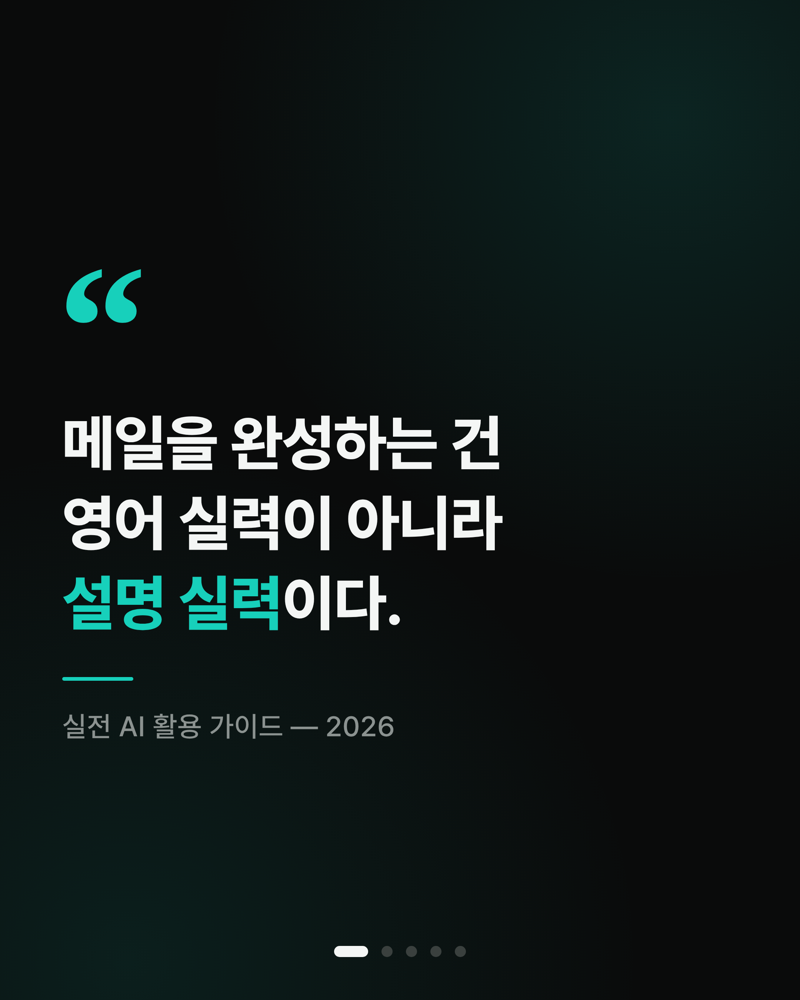

현재 **"실전 AI 활용 가이드" 시리즈 10종**(각 5장, 총 50장)이 예시로 들어 있습니다.

| slug | 주제 | | slug | 주제 |
|------|------|---|------|------|
| `1-email`   | 영어 이메일 | | `6-refuse`    | 거절의 기술 |
| `2-meeting` | 회의록 정리 | | `7-rehearsal` | 협상 리허설 |
| `3-report`  | 보고서 초안 | | `8-devil`     | 악마의 변호인 |
| `4-excel`   | 엑셀 · 데이터 | | `9-explain`   | 눈높이 번역기 |
| `5-resume`  | 자기소개서 | | `10-cooldown` | 감정 쿨다운 |

## 폴더 구조

| 파일 | 역할 |
|------|------|
| `slides.js`   | **여기만 고치면 됩니다.** 캐러셀 내용 + 템플릿 (`CAROUSELS` 배열) |
| `styles.css`  | 디자인 시스템(색·폰트·레이아웃) |
| `index.html`  | 브라우저 미리보기 (상단 버튼으로 캐러셀 선택, ← → 로 슬라이드 이동) |
| `render.html` | PNG 추출용 렌더 페이지 (직접 열 필요 없음) |
| `export.mjs`  | 각 슬라이드를 `out/<slug>/slide-NN.png` 로 저장 |
| `server.mjs`  | 로컬 미리보기 서버 |
| `reel.js`     | **쇼츠 쇼릴** — 장면·문구(`COPY`)·타임라인(`SCENES`). 모든 프레임을 캔버스에 그림 |
| `reel.html`   | 쇼릴 실시간 미리보기 (Space 정지, ← → 1초 이동, R 처음) |
| `export-reel.mjs` | 프레임을 ffmpeg 로 흘려 `out/reel/reel.mp4` + 씬별 스틸 PNG 생성 |
| `DESIGN.md`   | Teal Noir(디자인) · 단언체(톤) 규칙 |
| `fonts/`      | Pretendard woff2 (오프라인용) |
| `out/`        | 추출된 PNG 결과물 (캐러셀별 폴더) |

## 사용법

```bash
npm install          # 최초 1회 (Playwright 설치)

npm run serve        # http://localhost:8080 에서 미리보기
npm run export       # 모든 캐러셀을 out/<slug>/ 에 PNG 저장 (기본 2160×2700, 고해상도)
```

- 정확히 1080×1350 로 뽑으려면: `SCALE=1 npm run export`
- 특정 캐러셀만: `SLUG=2-meeting npm run export`
- 이 저장소 환경에서는 사전 설치된 Chromium 을 사용합니다. 다른 경로면:
  `CHROMIUM_PATH=/path/to/chrome npm run export`

## 쇼츠 쇼릴 (MP4)

```bash
npm run serve        # http://localhost:8080/reel.html 에서 실시간 재생
npm run reel         # out/reel/reel.mp4 (1080×1920, 30fps, 40초) + out/reel/still-NN.png
npm run reel:stills  # 씬별 스틸만 (빠른 검수용)
```

- 다른 버전 뽑기: `REEL=claude-class npm run reel` (또는 `npm run reel:claude`) → `out/reel-claude-class/`
  미리보기는 `reel.html?v=claude-class`. 버전 목록과 문구는 `reel.js` 상단 `VARIANTS` 에 있습니다.
- 구간만 뽑기: `START=9 END=18 npm run reel`
- ffmpeg 가 필요합니다 (`FFMPEG=/path/to/ffmpeg` 로 경로 지정 가능). 프레임은 디스크를 거치지 않고 바로 인코딩됩니다.
- 장면 구성: 훅(빠른 컷) → 터미널 → 키네틱 타이포 + 바우하우스 그리드 → 3D 파티클 → 대시보드 → 터널·글리치 → 타이틀.
  문구는 `reel.js` 상단 `VARIANTS` 의 각 버전, 색은 `C`, 각 씬 길이는 `SCENES` 에서 바꿉니다.
  새 버전은 기존 항목 하나를 복사해 이름만 바꿔 추가하면 됩니다. 긴 문구는 화면 폭에 맞춰 자동으로 줄어듭니다.
- 오디오는 포함되지 않습니다. 업로드 시 편집 앱에서 BGM 을 얹으세요 (128 BPM 전자음 계열 권장).

| 훅 | 터미널 | 타이포 | 파티클 | 대시보드 | 글리치 | 타이틀 |
|---|---|---|---|---|---|---|
| 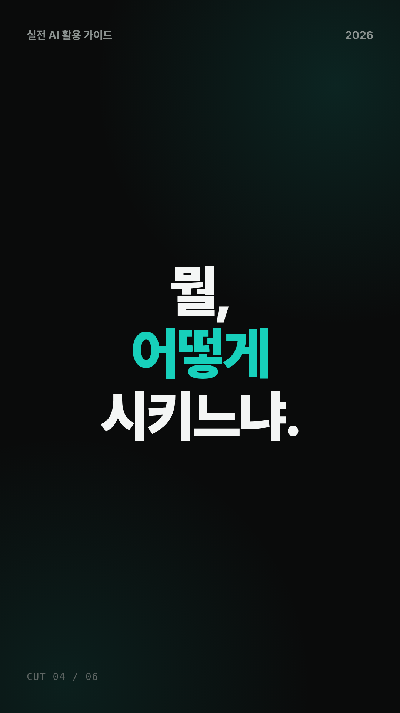 | 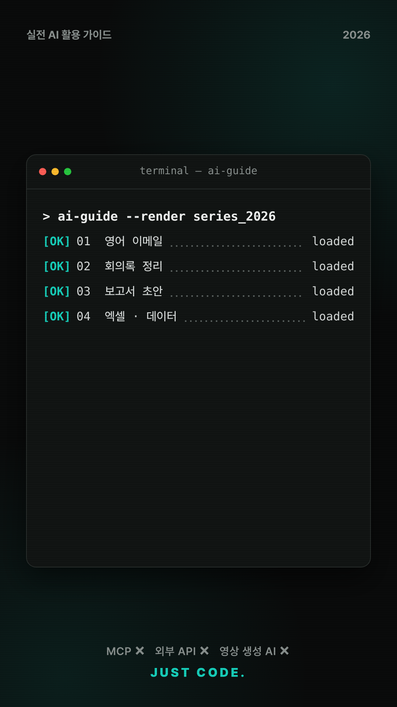 | 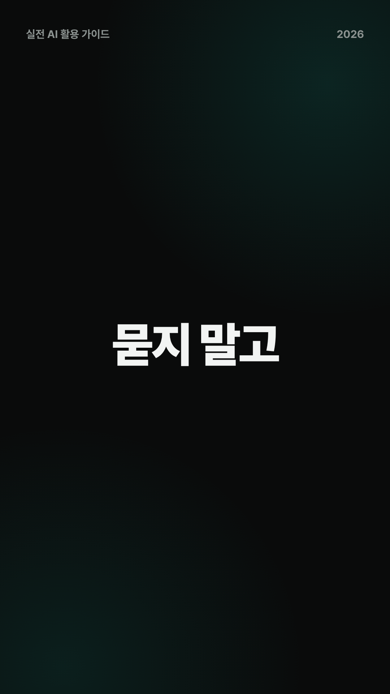 | 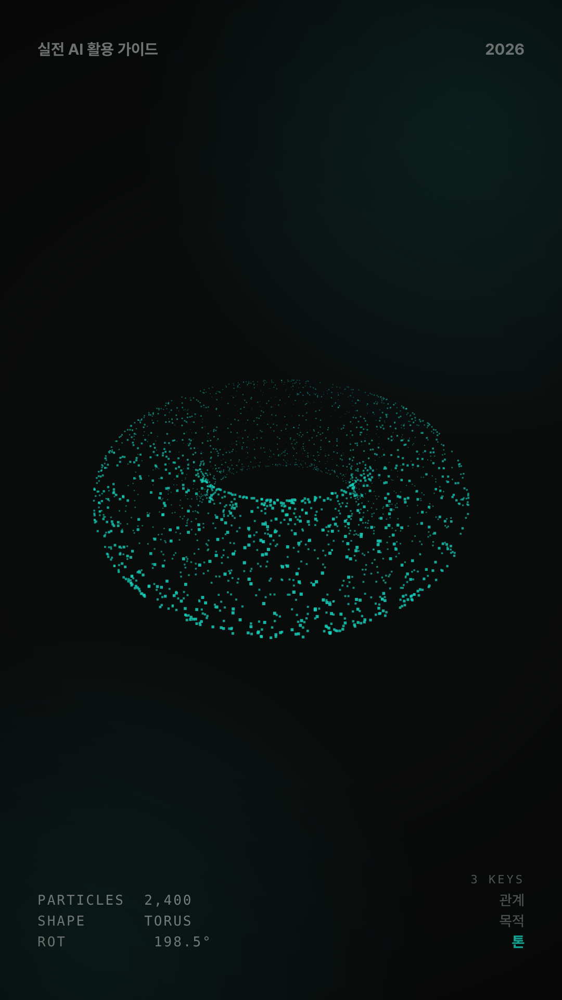 | 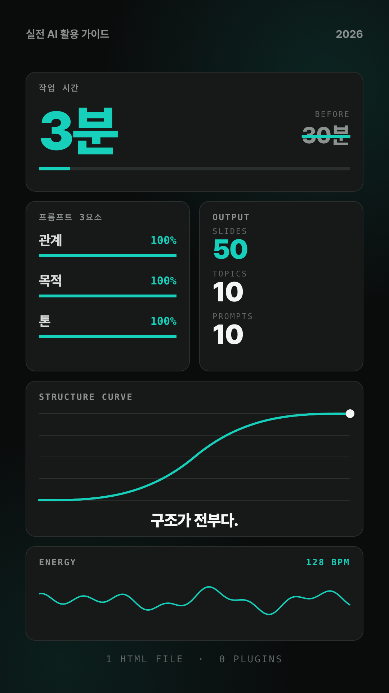 | 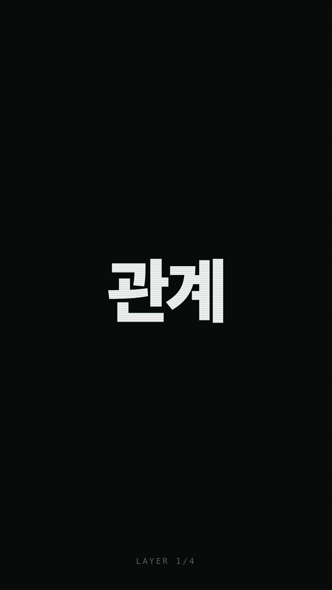 | 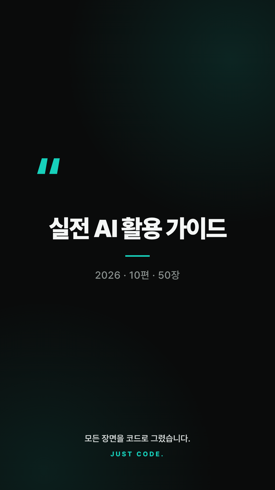 |

## 새 캐러셀 만들기

`slides.js` 의 `CAROUSELS` 배열에 `{ slug, title, slides: [...] }` 를 추가하세요.
`slug` 는 PNG 저장 폴더 이름, `slides` 는 슬라이드 배열이며 각 항목의 `type` 으로 레이아웃을 고릅니다.

| type | 레이아웃 | 주요 필드 |
|------|----------|-----------|
| `quote`    | 표지 인용구 | `headline`, `caption` |
| `hook`     | 이메일 목업 + 헤드라인 | `mail{to,line1,line2,line3,sticker}`, `headline` |
| `section`  | before → after 카드 | `badge`, `title`, `before{label,body}`, `after{label,body}`, `footer` |
| `timeline` | 아이콘 타임라인 | `badge`, `title`, `items[{icon,title,desc}]`, `pill` |
| `chat`     | 채팅(프롬프트) 목업 | `badge`, `title`, `window`, `prompt`, `respTitle`, `footer` |

### 텍스트 팁
- **줄바꿈**: 문자열 안에 `\n`
- **청록 강조**: `<span class="tl">강조할 부분</span>`
- **더 크게**: `hook` 헤드라인에서 `<span class="tl big">`
- 타임라인 아이콘: `people` · `target` · `pencil` (추가하려면 `slides.js` 의 `ICONS` 참고)

### 색/폰트 바꾸기
`styles.css` 상단 `:root` 의 CSS 변수만 수정하면 전체에 반영됩니다.
포인트 컬러는 `--accent`, 배경은 `--bg` 입니다.

## 규격
- 캔버스: **1080 × 1350 px (4:5)** — 인스타그램 세로 캐러셀 권장 규격
- 폰트: Pretendard (OFL, 저장소 포함)

### 버전 2 — 클로드 실전 강의 (샘플)

강의 모집용 샘플입니다. 주차·강 수·시간 같은 수치는 예시이니 실제 커리큘럼에 맞게 고쳐 쓰세요.

| 훅 | 터미널 | 타이포 | 파티클 | 대시보드 | 글리치 | 타이틀 |
|---|---|---|---|---|---|---|
| 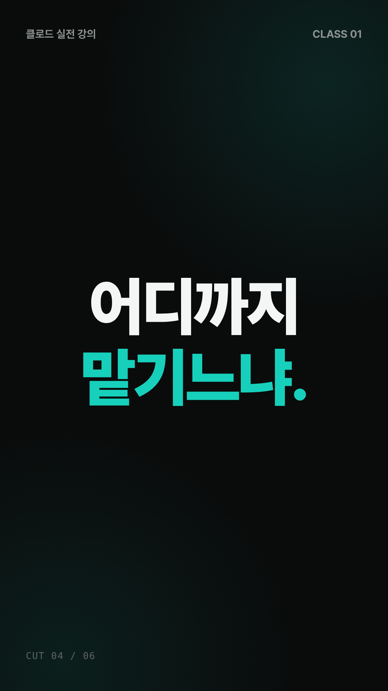 | 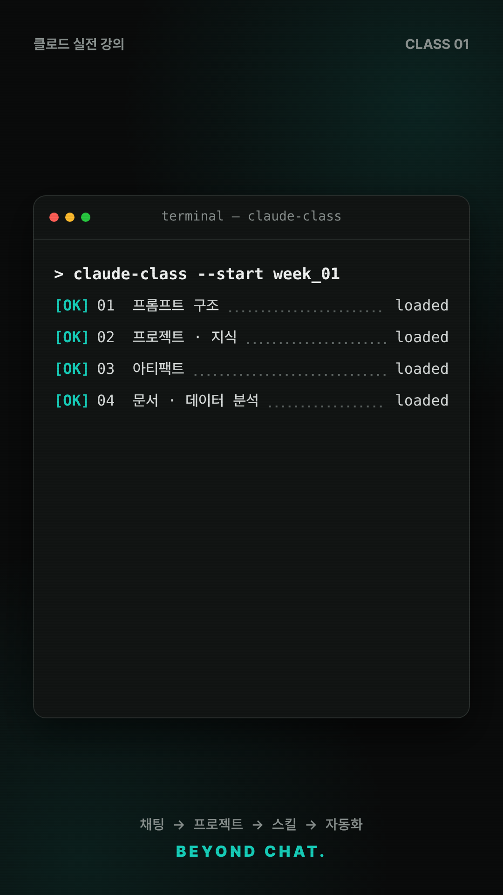 | 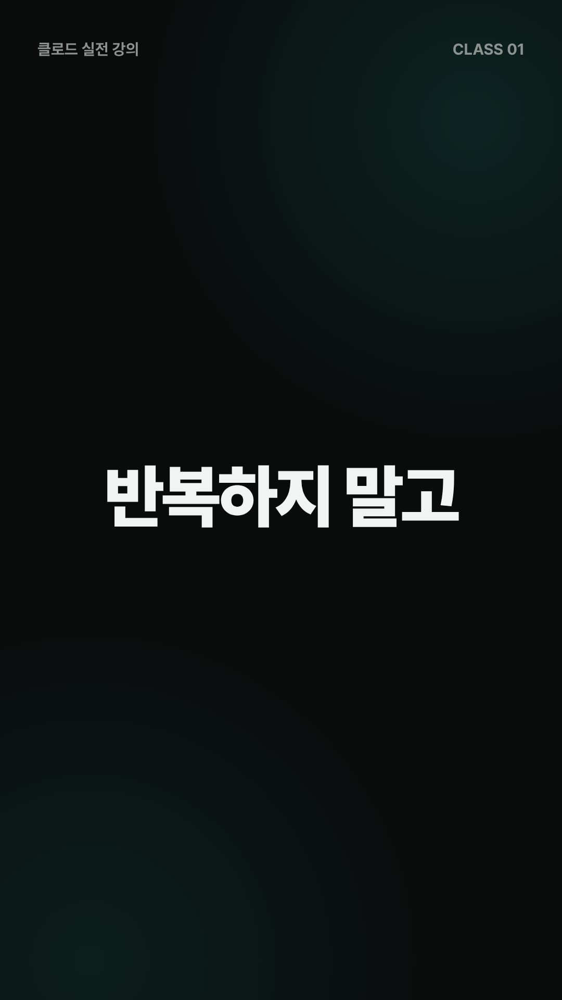 | 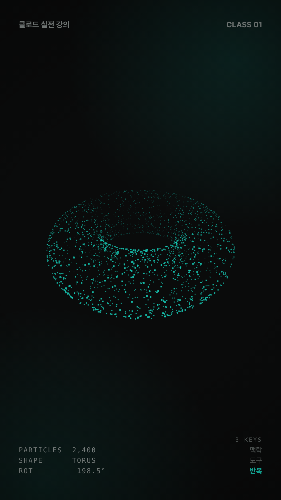 | 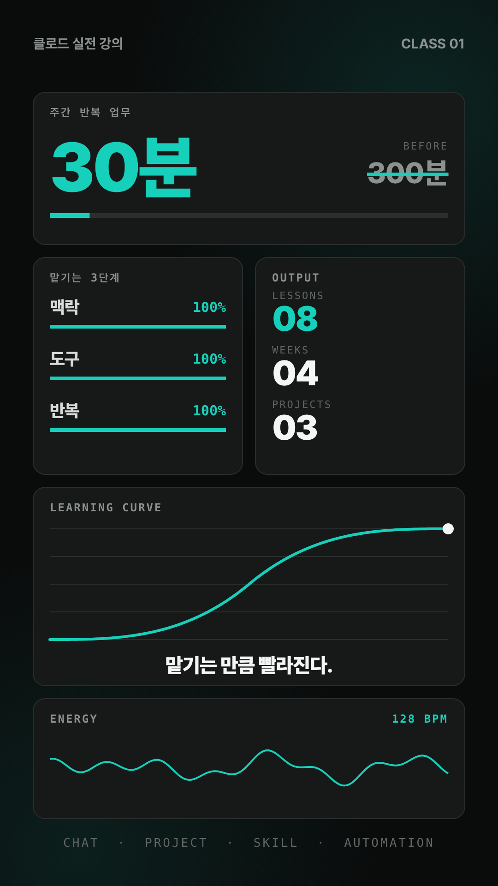 | 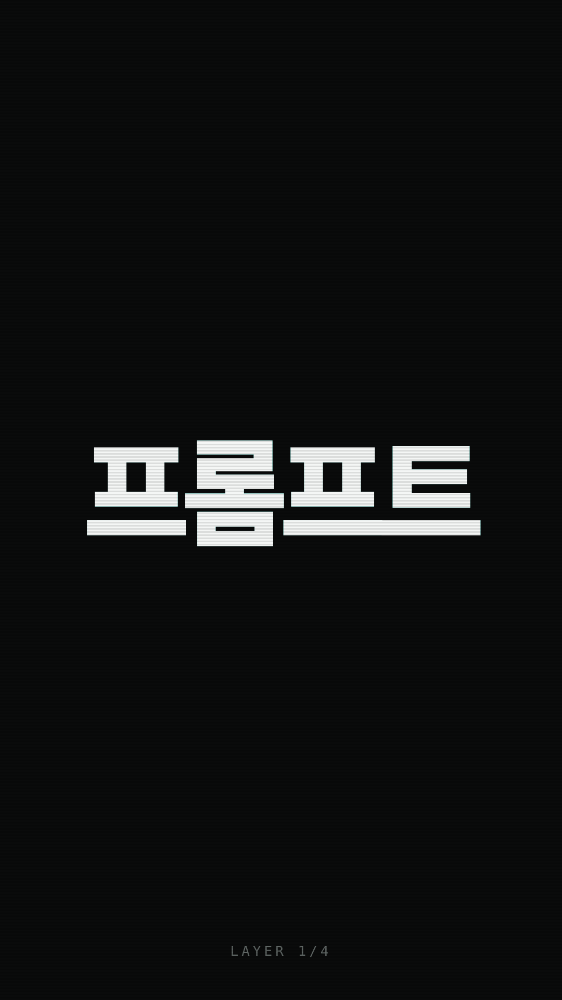 | 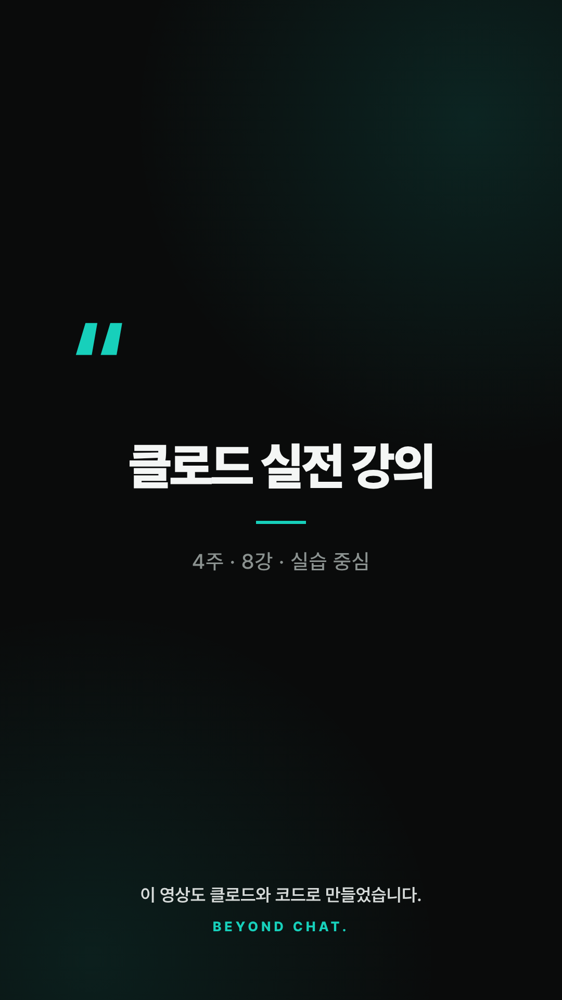 |
