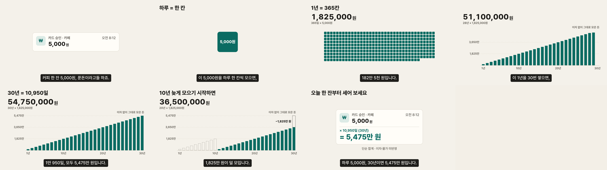

# 하루 커피값 5,000원, 30년이면? — 30초 설명 영상

For early-career Koreans who think a 5,000원 coffee is pocket change. After 30 seconds they can say **"하루 5,000원, 30년이면 5,475만 원"**.



## Deliverables

| File | What it is |
|---|---|
| `out/master_16x9.mp4` | 1920×1080, 60 fps, 30 s, H.264 + AAC |
| `out/cut_9x16.mp4` | 1080×1920 recomposition for Shorts and Reels |
| `out/cut_1x1.mp4` | 1080×1080 recomposition |
| `out/master_16x9_reduced_motion.mp4` | Same sequence of ideas with no travel: crossfades instead of moves |
| `captions.srt` | Narration track; also burned into every video |
| `contact.png` | One frame per beat, 16:9 |
| `film.js`, `film.html` | Source. `window.seek(t)` paints frame t; `TIMELINE` holds every beat, move, caption and cue |
| `SCENES.md`, `DECISIONS.md`, `SOURCES.md`, `directions.html` | Scene spec, decision log, where each number comes from, the three design directions |
| `out/review/` | Before/after frame pairs for each fix from the design review |

MP4 and WAV files are not committed. Rebuild them from the repo root:

```bash
npm install
npm run film          # all four videos, audio, captions, stills, contact sheet (≈6 min)
npm run film:check    # contrast, caption reading speed, text fit, determinism
node explainer/check-video.mjs explainer/coffee/out/cut_9x16.mp4
```

Preview in a browser with `npm run serve`, then open `http://localhost:8080/explainer/coffee/film.html?fmt=9x16`. Other parameters: `fmt=16x9|1x1`, `rm=1` for reduced motion, `theme=noir|blueprint` for the rejected directions.

## What was tested

These are measured results from the files in `out/`, as built on 2026-10-11.

| Check | How | Result |
|---|---|---|
| Determinism | Same frame (t = 19.37 s, and t = 8.13 s in 9:16) rendered in two fresh page loads, SHA-256 compared | Identical |
| Arithmetic | Every number is computed in `film.js` from 5,000 × 365 × 30. An independent reviewer redid the sums from the frames | All match (see SOURCES.md) |
| Loudness | `ebur128` on each finished MP4 | −15.9 LUFS integrated, −1.5 dBTP true peak, all four files |
| Flashes | Frame-to-frame average luma over every frame | 0 jumps of 10% or more, all four files (3 per second allowed) |
| Contrast | WCAG ratio for every text/background pair in the theme | Lowest text pair 5.18:1; bars 5.65:1 against the background |
| Color not the only signal | Design review | The 10 missed years are hollow and dashed, not only recolored |
| Caption reading speed | Characters (without spaces) per second | Worst 8.9 (limit 9) |
| Text fit | Every format, normal and reduced motion, every 0.25 s | No text shrank to fit |
| 390 px width | 9:16 beat frames scaled to 390 px and read | Every line readable; smallest essential text is 38 px (≈14 px on screen) |
| Shorts/Reels overlay | Caption box position in 9:16 | Ends at y = 1480, above the bottom 20% (y ≥ 1536) |
| Muted viewing | 1-per-second frame sheets of the 9:16 cut and the reduced-motion cut | Story reads from captions and visuals alone |
| Design review | Independent subagent; findings and fixes in DECISIONS.md #14–15 | Applied, with before/after pairs in `out/review/` |

**Not tested:** listening. The audio was checked only by measurement (loudness, peak, and a spectrum and waveform check of cue timing), not by ear. Captions were not checked by a native Korean speaker other than the author.

## Assumptions shown on screen
Plain sum: no interest, no inflation, no leap days. The chart says "이자 없이 그대로 모은 돈", and the last frame says "단순 합계 · 이자·물가 미반영". Details are in SOURCES.md.
