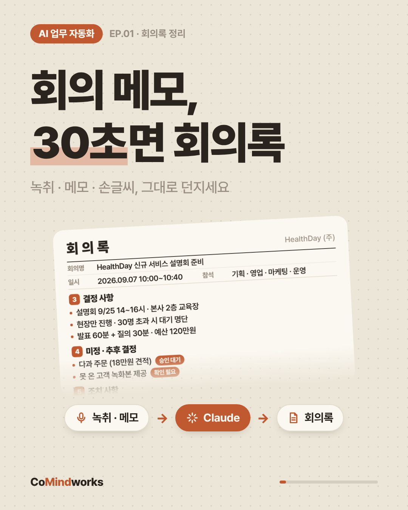
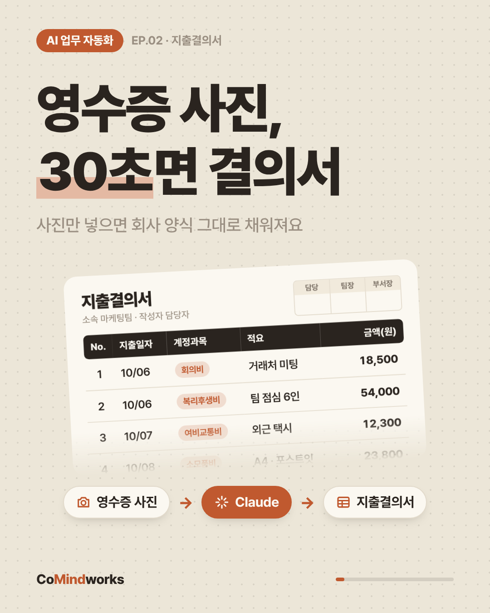

# 시리즈 2 'AI 업무 자동화' — 영상 버전 기획서

매일 올리는 7장 캐러셀을 **20~25초 피드 영상**으로 바꿉니다.
원고(`episode.js`) 하나로 MP4가 자동으로 나오고, 같은 원고면 언제 뽑아도 똑같은 영상이 나옵니다.

| EP.01 회의록 | EP.02 지출결의서 |
|---|---|
|  |  |

## 포맷

| 항목 | 결정 |
|---|---|
| 비율 | **4:5 피드형** 1080×1350, 30fps, H.264 + AAC |
| 길이 | 나레이션에 맞춰 자동. 지금은 추정치로 EP.01 약 52초, EP.02 약 46초 (실제 음성을 넣으면 다시 맞춰짐) |
| 속도 | `pace: 1.3`: 모든 움직임을 30% 느리게. 장면은 나레이션이 끝날 때까지 유지 |
| 소리 | **타입캐스트 나레이션 + 밝은 BGM + 효과음**. 나레이션 구간은 BGM을 자동으로 낮춤(덕킹), 자막 `.srt`도 함께 출력 |
| 디자인 | 시리즈 2 토큰 그대로: 크림 `#ECE6D8` + 도트, 러스트 `#C0592F`, 상단 pill · 하단 CoMindworks |
| 폰트 | A2Z (파일이 `fonts/`에 있으면 자동 적용, 없으면 Pretendard로 대체) |

## 7장 구조 → 영상 장면

| 장면 `type` | 원래 카드 | 연출 | 길이 |
|---|---|---|---|
| `hook`   | 1 표지 | 헤드라인 + 밑줄 그리기, 완성된 표 티저(합계 카운트업), 입력칩 흐름 | 3.4초 |
| `before` | 2 Before | 원본이 쌓임: 영수증 더미(`receipts`) 또는 회의 메모 + 녹취·사진 조각(`memo`), 'N분째' 카운터 | 3.8초 |
| `sheet`  | 3 핵심 + 4 After (표형) | 빈 양식 → 행이 하나씩 채워짐(타이핑·카운트업) → 합계 → '30초' 도장 | 9.0초 |
| `doc`    | 3 핵심 + 4 After (문서형) | 빈 회의록 양식 → 회의 정보 · 결정 · 미정('확인 필요' 태그) · 조치 표 순서로 채워짐 → 도장 | 10.2초 |
| `steps`  | 5 3단계 + 6 요약 | 3단계 카드가 차례로 들어옴 + 준비물 | 3.8초 |
| `cta`    | 7 CTA | 댓글창에 키워드 타이핑 → 배포 안내 → 팔로우 | 3.0~3.4초 |

원칙은 캐러셀과 같습니다. 장면 하나에 메시지 하나만 담고, 프롬프트와 양식은 영상에 넣지 않고 배포자료로만 전달합니다. 실명을 쓰지 않고, Parro 캐릭터는 등장시키지 않습니다.

## 나레이션 (타입캐스트)

장면마다 `episode.js`의 `vo`에 읽을 문장을 적어 둡니다. `npm run tts`는 타입캐스트 `POST /v1/text-to-speech/with-timestamps`로 장면별 음성과 단어 타이밍을 받아 `episodes/<ep>/vo/*.wav`와 `manifest.json`을 만들고, 영상은 그 실제 길이에 맞춰 장면 길이를 늘립니다.

- 모델은 기본 `ssfm-v30`이고 감정은 `smart`예요. 앞·뒤 장면 문장을 같이 넘겨서 이어지는 말투로 읽게 해요. 프리셋을 쓰려면 `TYPECAST_EMOTION_PRESET=happy`처럼 지정하세요.
- 숫자와 영문(30초, Claude 등)은 읽기용으로만 한글로 바꿔서 보내요. 화면과 자막은 원고 그대로예요.
- 원고·목소리·설정이 바뀐 줄만 다시 생성해서 유료 요청을 최소화해요.
- API 키는 `TYPECAST_API_KEY`를 먼저 보고, 없으면 `cast login`이 저장한 `~/.typecast/config.yaml`을 읽어요.
- 출처 표시: 요청 User-Agent 끝에 `typecast-integration/1 (source=api-page; generated_by=claude-code)`를 붙여요. 값은 `TYPECAST_INTEGRATION_SOURCE`, `TYPECAST_GENERATED_BY`로 바꿀 수 있어요.

```bash
npm run tts -- --voices              # 한국어 목소리 목록 (voice_id · 이름 · 감정)
export TYPECAST_VOICE_ID=...         # 고른 목소리
npm run tts                          # 장면별 음성 생성 (선택: TYPECAST_TEMPO=0.95)
npm run video                        # 나레이션 포함 MP4 + 자막 .srt
```

음성이 아직 없으면 원고 글자 수로 길이를 추정해 장면 길이만 잡고, 소리는 BGM과 효과음만 들어갑니다.

## CapCut으로 내보내기 (AutoFlowCut)

`npm run afc`는 에피소드를 [AutoFlowCut](https://github.com/touchizen/AutoFlowCut) 프로젝트 재료로 바꿔 `out/afc/<ep>/`에 둡니다.
- 문장 1개가 컷 1개예요. 컷 이미지는 우리 영상에서 그 문장이 끝나는 순간의 화면이에요.
- 씬 CSV, 나레이션, 문장 자막, BGM이 함께 만들어져요.

PC에서 AutoFlowCut 앱과 MCP 서버를 켜고 `autoflowcut-sns-export` 스킬을 실행하면 CapCut 프로젝트까지 내보내요.

## 효과음 큐

| 소리 | 쓰는 곳 |
|---|---|
| `whoosh` | 장면 전환 |
| `pop` | 카드·칩 등장 |
| `drop` | 영수증 떨어짐 |
| `type` | 행 입력, 댓글 타이핑 |
| `ding` | 합계 완성 |
| `stamp` | 30초 도장 |

BGM(108bpm D장조: 기타 스트럼, 베이스, 글로켄, 킥·클랩·셰이커)과 효과음은 `audio.mjs`가 코드로 합성하므로 음원 저작권을 신경 쓸 필요가 없습니다.
갖고 있는 음원을 쓰려면 `BGM=음원.mp3 npm run video`로 실행하세요. 효과음 위에 -14dB로 깔고, 나레이션 구간은 더 낮추고, 끝을 페이드아웃합니다.

## 사용법

```bash
npm install                             # 최초 1회
npm run serve                           # http://localhost:8080/video/video.html?ep=ep01-meeting 미리보기 (Space 재생)
npm run video                           # 모든 편 → out/video/<ep>/<ep>.mp4 + cover.png
EP=ep01-meeting npm run video           # 특정 편만
STILLS=1.5,8,14 EP=ep01-meeting npm run video   # 특정 시각 스틸만 빠르게 확인
```

렌더링은 영상 1초당 약 2.5초 걸립니다(50초 영상이면 약 2분).

## 새 편 만들기 (매일 루틴)

1. **검증 게이트 통과**: 실제 Claude로 처음부터 끝까지 돌려보고 결과물을 확보합니다.
2. 결과물이 표면 `episodes/ep02-receipt/`, 문서면 `episodes/ep01-meeting/`을 복사해 `epNN-주제/`를 만듭니다.
3. `episode.js`의 문구와 데이터(영수증 → 원본, 표 → 실제 결과물)를 바꿉니다.
4. `npm run serve`로 미리보며 장면 길이(`dur`)를 조정합니다.
5. `EP=epNN-주제 npm run video`로 렌더링합니다.
6. `캡션.txt`와 `배포자료/`(양식, 프롬프트)를 함께 정리하고 게시합니다.

> 지금 결과물 프레임은 **표형**(`sheet`)과 **문서형**(`doc`)이 있습니다. 대화형·화면형·설정형은 주제가 나올 때 `scenes.js`에 같은 방식으로 장면 템플릿을 추가하면 됩니다.

## 파일

| 파일 | 역할 |
|---|---|
| `engine.js` | 타임라인 엔진. 애니메이션을 일시정지해 두고 `seek(t)`로 프레임을 그림 |
| `scenes.js` | 장면 템플릿 (hook · before · sheet · doc · steps · cta) |
| `video.css` | 시리즈 2 디자인 토큰 |
| `video.html` | 미리보기 플레이어 / 렌더 페이지 (`?render=1`) |
| `audio.mjs` | BGM·효과음 합성 + 나레이션 믹스(덕킹) → WAV |
| `afc-bundle.mjs` | AutoFlowCut 번들(씬 CSV · 컷 이미지 · 나레이션 · 자막 · BGM) 생성 |
| `tts.mjs` | 타입캐스트로 장면별 나레이션 생성 → `vo/*.wav` + `manifest.json` |
| `render.mjs` | 프레임 캡처 → ffmpeg로 MP4 생성 |
| `episodes/<ep>/` | `episode.js`(원고) · `캡션.txt` · `배포자료/` |

## 편별 상태

| 편 | 원본 | 상태 |
|---|---|---|
| EP.01 회의록 | 노션 배포 페이지 EP.1 실습 파일(`회의메모`, `회의록_양식.docx`). 영상 속 회의록 내용은 이 메모에서 옮김 | 영상 · 캡션 · 배포자료 완료 |
| EP.02 지출결의서 | 노션 배포 페이지 EP.2 양식 · 프롬프트. 영수증 4장은 예시 데이터 | 영상 · 캡션 · 배포자료 완료. 실제 영수증 결과로 교체 권장 |

- [ ] 타입캐스트 나레이션 생성 (`TYPECAST_API_KEY`, `TYPECAST_VOICE_ID` 필요)
- [ ] A2Z 폰트 적용 (`fonts/A2Z-*.woff2` 추가)
- [ ] CTA 댓글 키워드("회의록", "영수증")가 실제 DM 자동화 키워드와 같은지 확인
